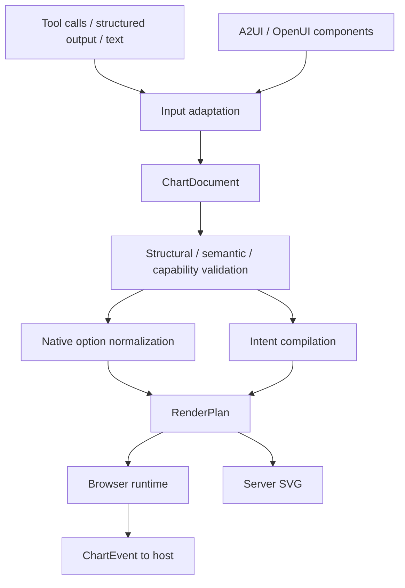

# Technical architecture and design

[简体中文](../zh-CN/architecture.md)

## Data flow

## Layers and dependencies
| Module | Responsibility | Forbidden dependencies |
| --- | --- | --- |
| schema | Language-neutral documents, operations, events, diagnostics | DOM, ECharts runtime, model SDKs |
| core | Data semantics, validation, intent compilation, normalization | Network, DOM, React, model SDKs |
| echarts | Version/module capabilities and render-plan integration | Model vendors, UI protocols |
| runtime | DOM lifecycle, updates, events, interaction state | Model SDKs, protocol parsers |
| render | Node SVG output and resource limits | Browser UI frameworks |
| react | React lifecycle bindings | Model vendors |
| adapter-* | Upstream component registration, bindings, lifecycle, event mapping | Other adapters' internals |
| mcp / cli | Tool and command entry points sharing the core | Duplicate compilers |

Allowed direction: outer entry points → core/schema; runtime/render → echarts; framework and protocol wrappers → runtime. Core must not import outer packages. These are target boundaries; P1 may keep ECharts integration inside runtime and extract it later.

## Two inputs
- `mode: echarts`: native JSON option, preserving existing ECharts usage. Apply configuration restrictions and implemented semantic checks without claiming complete validation of all ECharts types and runtime constraints.
- `mode: intent`: compact chart types, field mappings, presentation, and interaction. The compiler owns series/dataset/encode details.
Modes are mutually exclusive without implicit precedence. Arbitrary option merging must not bypass validation. Host-registered code extensions are referenced through stable IDs and parameter schemas.

## Deterministic compilation
Inputs are the document, resolved data, a capability profile, and explicit locale/timezone/theme. Outputs are a RenderPlan, diagnostics, and compiler metadata. Specify defaults. Do not depend on implicit current time, randomness, browser language, or network response changes.
Core does not fetch arbitrary URLs. The host authorizes and resolves data and supplies values with revisions. Asynchronous resolution belongs to an outer resolver interface and completes before pure compilation.

## Rendering and state
Use stable series/dataset IDs. Explicitly choose merge, replaceMerge, or recreation; do not forward protocol patches directly to setOption. Test chart-type transitions, series deletion, empty data, and zero-size containers.
Runtime owns instances: one owner per container. Resize observers must be removable and disposal idempotent. SSR exports must not import DOM modules. Store zoom and legend state separately; remove invalid state when fields or series change.
SVG is static output and does not establish browser interaction. Do not promise pixel-identical rendering across platforms. Pin browser, fonts, dimensions, and animation settings for visual baselines.

## Choices and alternatives
- TypeScript strict and pnpm workspaces; JSON Schema 2020-12 is the external contract source, Ajv validates structure, and semantic rules are separate.
- ECharts as a peer dependency; pin a tested baseline and record verified compatibility ranges.
- Vitest, Playwright, Changesets, and GitHub Actions; verify and pin exact versions during initialization.
- Markdown/VitePress documentation. No remote cache, service database, or unified model gateway initially.
- Borrow field-mapping concepts from Vega-Lite without promising language compatibility; a complete port expands first-release scope.

## Protocol integration
Reuse upstream parsers. Map OpenUI custom components to ChartDocument; commit partially parsed output only when it forms a complete valid chart state. Verify A2UI version, catalog, binding, and events independently. Treat AG-UI as event/transport integration rather than another chart semantics layer.
List OpenUI's experimental A2UI profile separately from standard A2UI. Neither is evidence of compatibility with the other.

## Open questions
Verify the canonical A2UI repository/version, npm scope availability, ECharts and Node baselines, the initial native-option capability set, and inline-data/render budgets during P0. Pin these before implementation rather than advertising guessed support.
