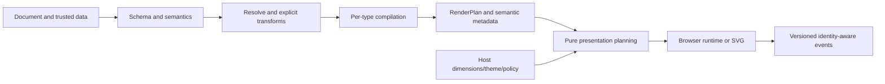

# RFC: foundational quality, host presentation and four new chart types

[简体中文](../zh-CN/technical-design-2026-10-31.md)

## Status and principles

This RFC is **partially implemented** following the [technical review](project-review-2026-10-31.md). M0–M3 are accepted locally: [0.3 contracts](contracts-03.md) and [chat host quality](chat-host-quality.md) describe actual APIs, evidence and limits. D07/D08 renderers and host map assets are implemented; [M3 guide](chart-expansion-03.md) freezes their actual APIs and limits. D09/D10 tooling and distribution are implemented in [M4](trial-distribution.md); the pushed implementation passes Linux CI, while full model evaluation and final-report acceptance remain pending. See the [action plan](action-plan-2026-10-31.md).

Target basic, general, explainable chat charts: few useful options, faithful data semantics, two clean themes, five detail levels, and one core for multiple models/hosts. Do not fetch data, execute model code, implicitly sort/aggregate/convert or invent facts. Tree means **node-link tree**, not treemap. Map means **GeoJSON regional choropleth**, excluding tiles, online basemaps, tracks, 3D and geocoding. These advanced features are not delivery requirements.

## D01: correct existing semantics and preserve compatibility

- All-zero pie/donut: retain source values and identity, explicitly set `stillShowZeroSum:false`, and expose a `NO_SHARE_DATA` notice with accessible no-share text. Never draw equal shares. Empty and all-zero states differ; null never becomes zero. Guarded native retains its declared extension boundary rather than silently rewriting every native chart.
- Grouping: derive internal series keys from the field and original group value, not display names. Define deterministic empty-label/collision handling and preserve raw labels in metadata. Reordering must not change keys. Do not silently merge ambiguous legend targets.
- Keep native guarded-partial and strict-basic distinct. Tool results identify validation level. Structural validity, compilation, rendering and verified host operation are separate evidence dimensions.
- Restrict 0.1/0.2 changes to justified fixes. Changes to valid input structure, default presentation or event identity need a new version or explicit host opt-in. Corrections to previously wrong output still need migration notes and regressions.

## D02: discriminated 0.3 contract and model entry

Concentrate structural expansion in experimental **ChartDocument 0.3**. Keep 0.1 native/intent and 0.2 intent readable; do not add 0.3 native yet. This avoids meaningless x/y fields for tree/Sankey/radar and more globally optional fields in the 0.2 chart object.

Use `chart.type` to discriminate eleven branches, each containing only valid local fields. Preserve valid semantics of the existing seven types and share field/unit/sort definitions. JSON Schema owns type-local structure; compilation owns references, ranges, cycles, ambiguous identity and budgets. Structural validity does not guarantee semantic validity, but missing heatmap configuration should fail structurally.

Each model entry receives the target version, a projected schema for the chosen chart, capabilities, and one positive and one error/repair example. Offer both full and projected schemas generated from one source, with equivalence tests, instead of forcing every model to receive the whole union. Preserve the existing `get_chart_schema` default; add explicit `chartType`/version selection rather than silently upgrading it.

For the new version, propose optional `presentation: {theme: "light"|"dark", detailLevel: ...}` without model-facing theme.version; host policy resolves actual theme/background. Migrate old `{id,version}` explicitly. Only migrate when semantics can be proven equivalent; never guess aggregate identities. Reject unknown fields with exact paths rather than deleting them to make validation pass.

## D03: compilation, presentation and rendering

Preserve package boundaries and split responsibilities inside core before adding packages:



Suggested internal responsibilities: `data/resolve`, `data/transforms`, `charts/{type}`, `presentation/{theme,detail,layout}`, `diagnostics`. Use existing numeric/identity golden tests to preserve behavior during extraction. New types must not derive semantics by compiling another chart and replacing its type.

Retain RenderPlan.option for ECharts and add versioned metadata (compiler build, presentation version and capability digest) rather than a full second graphics language: series/item keys, raw labels, units, nulls, empty state, necessary legends/scales and table-column definitions. Errors remain Result failures. Nonfatal changes use structured notices with code/path/params, with a compatibility mapping for old adjustments.

Conceptual pure API: `resolvePresentation(plan, context) -> {option, notices, accessibility}`. Context supplies explicit dimensions, light/dark, transparent/theme, detail level and bounded measurement results. Core does not inspect DOM, system theme or fonts. Browsers measure; SVG supplies explicit dimensions/font assumptions. Missing dimensions use a declared static default without a responsive-layout claim.

## D04: dimensions, themes, levels and alternatives

**Precedence**: safety/resource constraints and semantic minimum information → host accessibility/presentation policy → explicit document preferences → level defaults. Explain visible changes with notices. Hosts may reject layouts beyond capacity but must not silently drop data, change units/type or select Top N.

Initial design thresholds use chart content width, not viewport width: below 240px recommend text/table fallback; 240–359px compact; 360–559px regular; at least 560px wide. These are parameters awaiting verification, not new data rejection rules. Height, axis count and measured labels also matter. Narrow dual axes may require more space or fallback.

| Level | Default content | Mandatory information |
| --- | --- | --- |
| minimal | Geometry and necessary orientation; title may live in chat text | Identity, units, scales and nonvisual alternative |
| simple | Supplied title and main ticks | Same |
| standard | Normal ticks, light grid, necessary legend; default | Same |
| detailed | Data labels and context where space permits | No data deletion for density |
| comprehensive | Fuller tick/unit explanations and supported exploration | Does not enable dual axes, zoom or toolbars automatically |

Levels control information density, not chart capability. Adjacent levels may look identical for non-Cartesian charts. Explicit dense labels remain subject to readability policy, with notices or table alternatives instead of unconditional overlap.

Reserve at most two lines for titles/axis names and provide full-text access. Truncate/thin category ticks according to measured budgets, retaining raw values. Allocate title, legend, axes/scales, plot and data labels in order. Browser legends need keyboard-operable host controls or accessible pagination. Static export cannot depend on scrolling: fit all required content, enlarge dimensions or report export limits.

Shared theme tokens own primary/secondary text, axes, grids, tooltip, categorical and continuous colors. Transparent surfaces are readable only under declared host conditions; never infer the surface from model prose. Outer layers respect reduced motion; retain the current no-animation default. Target ≥4.5:1 normal text contrast on declared surfaces and ≥3:1 essential graphics/controls; color alone must not encode identity. Claim only the combinations actually checked, not universal WCAG certification.

Each chart has a deterministic summary and data table including units, nulls, raw categories and source identifiers; no invented analysis or causal interpretation. Paginate with counts when needed without dropping data. Legend toggles and data access need keyboard paths; hover is supplemental. Deliver SVG with associated summary/table metadata rather than describing static SVG as interactive UI.

## D05: lifecycle, identity, state and transactions

Adapters use `unmounted → waiting-for-size → ready → disposed`. While waiting, retain the latest complete valid input; zero size is not a recurring error loop. Cancel observers/pending work on disposal. Keep mountChart's immediate failure contract and implement waiting in an outer coordinator.

Separate data updates from layout updates: resize/theme do not advance data revision; successful document commit does. Layout uses the last successful plan, not potentially mutated caller input. Failure preserves committed plan, revision and identity mapping. Clear/restore/resize/callback failures need observable handling; callback errors are not data errors.

Add an optional declared stable row-key field in the new version, containing unique nonempty strings. Events prefer this identity; legacy inputs retain positional identity valid only at the current revision. Aggregates retain aggregate identity without fabricated row IDs. Tree nodes, Sankey nodes/edges and map regions need distinct identity variants rather than being forced into rowIndex.

Start interaction retention with legends keyed by semantic series/item identity. Intersect valid old/new keys and default new items to visible. Reset incompatible state when chart family, field mapping or units change and explain why. Support zoom only on declared continuous-axis profiles, storing value ranges rather than pixels; clamp to new domain and reset empty intersections. This does not imply existing profiles already support dataZoom.

Marklang stages in a measurable but noninteractive surface, not display:none. Validate, prepare resources and mount all charts before an atomic swap. Failure disposes only staging and retains the old view. Apply total document budgets and the existing 16-chart maximum, accounting for temporary old/new coexistence.

## D06: real streaming and protocol consistency

Move generic JSON buffering from the A2UI-specific export toward a protocol-neutral module while retaining a compatibility re-export. Transport owns incremental UTF-8 decoding, Ollama NDJSON/SSE framing, deadlines and AbortSignal. The buffer accepts decoded content and is not a protocol parser.

Bind generation to operationId, the starting baseRevision and a requestEpoch. Commit requires successful terminal transport indication, no cancellation, one complete JSON value, structural/semantic validity and a current revision. Parseable JSON followed by transport truncation is not success. Ignore late fragments after cancellation; show errors beside the previous chart. Permit at most two additional model repair attempts, validating each and recording initial versus repaired outcomes.

For OpenUI Lang, A2UI v0.9, COSUI JSON and Marklang, record SDK version, representation, completion signal, updates/disposal, events, errors, theme, size and resources. Reuse adapter contract tests but execute them in separate real upstream hosts. ChartNexus operations are not upstream standard fields. Start real transport validation with local Ollama; additional models require configured and authorized environments. Remote MCP is not mandatory new infrastructure for this phase.

## D07: four bounded chart contracts

These 0.3 fields are implemented under [SPEC-0035](../../specs/0035-chart-expansion/spec.md), with independent compiler/browser/SVG/worker and host evidence. Real-model held-out evaluation remains M4.

| Type | Proposed data/fields | Required checks | Initial scope |
| --- | --- | --- | --- |
| radar | Ordinary wide table, one row per item; `encoding.item.field`; `indicators:[{field,label,min,max,unit?}]` | 3–8 distinct numeric indicators; explicit finite min<max ranges; in-range values; unique item identity | 1–6 items; no inferred ranges/normalization; missing indicators explicitly rejected initially |
| tree | Ordinary table; `encoding:{id,parentId,label}` field references; root parentId null | Unique nonempty IDs, existing parents, one root, acyclic, all nodes reachable | Node-link tree; ≤1000 nodes, depth≤16; default expansion≤2 levels; node count is not value sum; no treemap |
| sankey | `data.kind:"graph"`, nodes/links each an inline/reference table; `encoding:{nodeId,nodeLabel,source,target,value}` | Stable node/edge identity, valid endpoints, finite nonnegative flow, no self-loops/directed cycles; reject duplicate source-target pairs | ≤200 nodes, ≤1000 edges; zero-weight links not drawn but retained in table; no inferred conservation; report totals/difference as metadata |
| map | Regional table; `encoding:{region,value}`; `mapRef:{id,revision}`; explicit colorDomain | Exact trusted region-key matches, reject duplicate/unknown regions, in-range values, null/missing use missing-data color | Choropleth only; no model GeoJSON/URLs, built-in political-boundary choice or online basemap |

Tree labels may repeat but IDs may not; presentation does not change topology. Collapsing changes visibility, not source data. SVG must explicitly describe a collapsed overview or use a full export when required. Sankey values are not automatically percentages. Radar mixed units require explicit ranges and explanations to avoid misleading comparison.

New types also obey the aggregate 1 MiB document/data budget; type-specific limits are additional caps. Tree traversal is O(n), Sankey cycle validation O(V+E), avoiding unbounded recursive input structures. Publish identical limits in schema, capabilities and runtime.


### Frozen chart branch examples (full document/data still required)

These are `chart` branch fragments. The common `schemaVersion:"0.3"`, id, data and mode envelope follows the definitions above. All encoding references use `{field}` objects rather than mixing strings and objects.

```json
{
  "type": "radar",
  "encoding": { "item": { "field": "team" } },
  "indicators": [
    { "field": "speed", "label": "Speed", "min": 0, "max": 100 },
    { "field": "quality", "label": "Quality", "min": 0, "max": 100 },
    { "field": "coverage", "label": "Coverage", "min": 0, "max": 100 }
  ]
}
```

```json
{
  "type": "tree",
  "encoding": {
    "id": { "field": "nodeId" },
    "parentId": { "field": "parentId" },
    "label": { "field": "name" }
  }
}
```

```json
{
  "type": "sankey",
  "encoding": {
    "nodeId": { "field": "id" },
    "nodeLabel": { "field": "label" },
    "source": { "field": "from" },
    "target": { "field": "to" },
    "value": { "field": "amount" }
  }
}
```

Sankey nodeId/nodeLabel resolve against `data.nodes`; the other fields resolve against `data.links`. Data is `{kind:"graph",nodes:<TableSource>,links:<TableSource>}`. With duplicate source-target pairs forbidden, ordered endpoints determine edge identity, never array positions. Node display labels may repeat; verify the ECharts identity mapping against the actual SDK. Resolve both tables into one commit snapshot; a registry revision mismatch fails the entire operation.

```json
{
  "type": "map",
  "mapRef": { "id": "sample-regions", "revision": "1" },
  "encoding": { "region": { "field": "regionId" }, "value": { "field": "amount" } },
  "colorDomain": { "min": 0, "max": 100 }
}
```

Complete documents, source data, host-map requirements and negative examples are in the [M3 guide](chart-expansion-03.md) and recipe manifest.

## D08: map assets and trust

Add a host MapRegistry separate from DataRegistry. Each asset has stable id/revision, content hash, region-key set, coordinate/projection convention, license and provenance. Geometry never goes in model prompts or ChartDocument. Initially accept host-checked GeoJSON FeatureCollection with Polygon/MultiPolygon only, excluding SVG maps and external links. Initially declare WGS84 longitude/latitude only, rejecting other CRS or implicit reprojection; check finite coordinates, longitude/latitude bounds, closed rings and minimum ring length. Proposed separate limits: ≤5 MiB, ≤20000 coordinate points and ≤1000 regions per asset, at most eight registered revisions per process and ≤20 MiB total source geometry, to be frozen after measurement.

Core receives only safe metadata/region keys. Rendering verifies the asset hash and limits before ECharts registration. Namespace registered names by id/revision/hash to avoid cross-host collisions. If ECharts global registration lacks reliable unloading, impose a bounded registration policy; fail on mismatched revisions/capacity rather than overwriting assets used elsewhere.

SVG workers receive the same trusted asset snapshot and register it locally under output/time budgets. Missing assets, revision mismatch and invalid geometry produce stable diagnostics; browser-only functionality is insufficient. Tests use two authored polygons rather than downloading administrative boundaries. Review redistribution rights before bundling any real map.

## D09: Agent resources, diagnostics and evaluation

Create an explicit registry for charts, versions, maturity, execution modes, constraints, recipes/repairs, upstream versions and provenance/licenses. Generate capability manifests, projected schemas, tool descriptions, recipe manifest, RAG entries, MCP discovery and support matrix. Do not infer capability versions from resource-ID suffixes. Track experimental/verified/not-run per dimension; compilation does not imply universal host support.

Diagnostics carry stable code, JSON Pointer, semantic reason and declarative repair guidance. Unknown fields list bounded valid choices; schema errors show expected type/enum. Never rewrite business data merely to pass. Inject host policy through service configuration; tool arguments are preferences and cannot override trust/resource/theme policy. Preserve and document compatibility for existing MCP parameters.

Use three corpora: public teaching recipes, public development regressions, and held-out tasks excluded from MCP/RAG/training packages. Evaluation owns provenance, family separation, data, expected outcomes and hashes; models receive only tasks and required data. Freeze model, prompt, schema/compiler hashes, temperature/seed and budgets. After prompt tuning, known failures become development repeats rather than fresh held-out results. Training friendliness means reusable licensed resources, not mandatory model training by this project.

Measure JSON/structural validity, compilation, data/unit/identity fidelity, task correctness, first-pass and repaired success, rounds, tool errors, cancellation and latency separately. Score model chart choice independently from deterministic rendering. Start with local-model baselines. Model-independent architecture does not prove every model works. Report sample sizes, repeats, confidence intervals and failures without generalizing tiny samples.

## D10: distribution, performance and release gates

Install all tarballs in clean temporary projects without workspace links. Verify Node 22/24, ESM exports, JSON resources, worker-relative paths, CLI bins, MCP stdio, React/San peers and LICENSE/NOTICE. Rehearse locally without npm publication. Check adapter peer/dependency versions independently without broadening untested compatibility ranges.

Once the ECharts module list is explicit, use selective registration in browsers and the same controlled capabilities in SSR/workers. Measure dependency composition before setting bundle budgets; demo size is not SDK size. Record compile, first render, update, memory and disposal loops at typical 100/1000 rows and bounded maximum loads. Use same-machine baseline ratios for regression gates and derive absolute SLAs from real host measurements.

CI separates generation/types/semantics, browser and package-install required jobs, preserving structured failures and relevant screenshots. Expensive/nondeterministic live-model evaluations run manually or under explicitly authorized scheduling, not every PR. Docs checks include paired status/date and evidence links. Rollback disables an independent profile/version without deleting data or forcing migration.

## Alternatives rejected

- Exposing all ECharts options: too broad for model correctness/safety; keep a controlled native path.
- Expanding the single 0.2 chart object: creates invalid combinations and meaningless x/y for graphs; use a versioned union.
- A large general graphics IR: not justified at this scale; minimal RenderPlan metadata suffices.
- Guessing theme, domain, order, maps, percentages or missing values: risks semantic changes; use explicit contracts/trusted hosts.
- One giant chart/refactor commit: impairs regression isolation; accept each type end to end.

## Decisions requiring evidence

Font measurement, width thresholds, map budgets, performance limits and model success thresholds need fixed-environment validation, not another round of routine user preferences. External unavailability must not block unrelated local work or be recorded as a pass. M1/M2 freeze a bounded layout with conservative text budgets and explicit fallback, not exact arbitrary-font measurement. Other proposed work remains unimplemented unless its linked spec records passing evidence.
