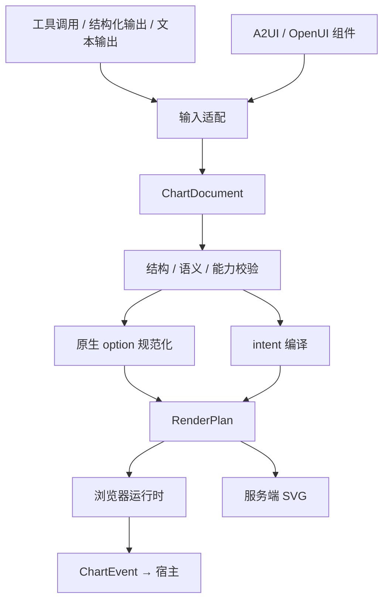

# 技术架构与设计方案

[English](../en/architecture.md)

## 数据路径

## 分层与依赖
| 模块 | 职责 | 禁止依赖 |
| --- | --- | --- |
| schema | 文档、操作、事件、诊断的语言无关契约 | DOM、ECharts 运行时、模型 SDK |
| core | 数据语义、校验、intent 编译、规范化 | 网络、DOM、React、模型 SDK |
| echarts | 按版本与模块声明能力，连接渲染计划和 ECharts | 模型厂商、UI 协议 |
| runtime | DOM 生命周期、更新策略、事件与交互状态 | 模型 SDK、协议解析器 |
| render | Node 环境 SVG 输出、资源限制 | 浏览器 UI 框架 |
| react | React 生命周期封装 | 模型厂商 |
| adapter-* | 上游组件注册、绑定、生命周期、事件映射 | 另一适配器内部实现 |
| mcp / cli | 工具与命令入口，复用核心 | 重复实现编译逻辑 |

允许方向：外围入口 → core/schema；runtime/render → echarts；框架与协议封装 → runtime。禁止核心反向导入外围包。包边界是目标，P1 可将 echarts 连接层放在 runtime 内，成熟后再拆。

## 两种输入
- `mode: echarts`：JSON 原生 option，保留现有 ECharts 使用路径。执行配置限制和已实现的语义检查，不声称覆盖全部 ECharts 类型与运行约束。
- `mode: intent`：简化的图表类型、字段映射、样式与交互描述。编译器负责 series/dataset/encode 等实现细节。
两种模式互斥，不定义隐式优先级。不将任意 option 合并作为绕过校验的入口。宿主代码注册的扩展通过稳定 ID 和参数 Schema 引用。

## 确定性编译
输入为文档、已解析数据、能力 profile 和显式 locale/timezone/theme；输出为 RenderPlan、诊断及编译元数据。默认值写入规范。不能依赖当前时间、随机数、浏览器语言或网络响应的隐式变化。
核心不得主动解析任意 URL；宿主负责授权和解析数据，向核心提供值与 revision。异步解析属于外围数据解析接口，完成后再进入纯编译阶段。

## 渲染与状态
RenderPlan 使用稳定 series/dataset ID。更新策略明确选择合并、replaceMerge 或重建，不直接把协议 patch 传给 setOption。图表切换、系列删除、空数据和尺寸为零必须有测试。
运行时持有实例；一个容器一个所有者。resize 监听可清理，dispose 幂等。SSR 导出不导入 DOM 模块。用户缩放与图例状态独立存储，字段/系列失效时按规则清理。
SVG 是静态输出，不能声明具备浏览器交互。首版不承诺像素级跨平台一致；视觉基线固定浏览器、字体、尺寸和动画设置。

## 选择与替代方案
- TypeScript strict + pnpm workspace；JSON Schema 2020-12 为对外契约源，Ajv 负责结构校验，语义规则独立。
- 原生 ECharts 作为 peer dependency；锁定测试基线，并在兼容矩阵记录实际支持区间。
- Vitest、Playwright、Changesets、GitHub Actions；具体版本在初始化时核实并锁定。
- 文档采用 Markdown/VitePress。先不增加远程缓存、服务数据库或统一模型网关。
- 借鉴 Vega-Lite 的字段映射思想，不承诺兼容其语言；完整移植会扩大首版范围。

## 协议接入策略
复用上游解析器。OpenUI 自定义组件映射至 ChartDocument；部分解析结果只有形成完整有效图表状态才提交。A2UI 单独核实版本、catalog、绑定和事件。AG-UI 作为事件/传输集成，不作为另一份图表语义。
OpenUI 的实验 A2UI profile 和标准 A2UI 分开列出兼容情况，不能互相替代验证。

## 已知不确定项
标准 A2UI 当前 canonical 仓库与版本、npm scope 可用性、ECharts 与 Node 基线版本、原生 option 首批允许能力、内联数据与渲染预算需要在 P0 用证据决策。实现前锁定，不用猜测值宣传支持。
